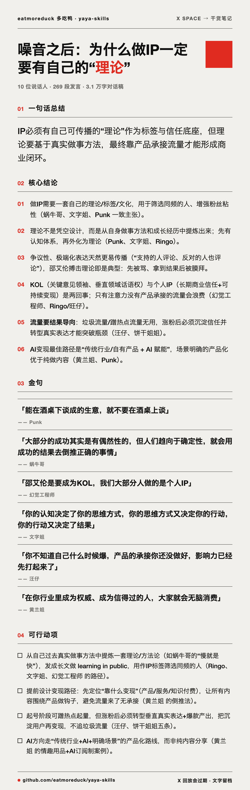
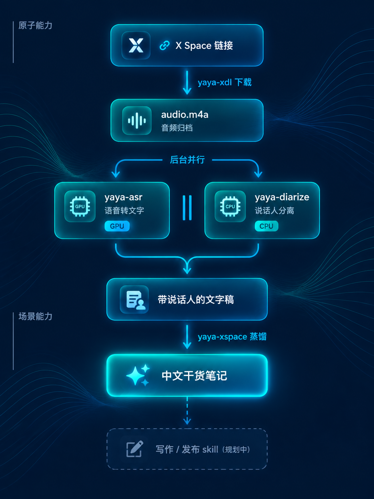

# yaya-skills

[English](README.en.md) | 简体中文


[](LICENSE)
[](https://github.com/eatmoreduck/yaya-skills)
[](#安装)


> **首期主打：X Space 录音转文字。** 开车、做饭时听到一段好内容，想记，手上忙着记不了；等忙完只剩个模糊印象，回放 30 天后还被平台直接删掉。一条链接，把一场两小时的 Space 变成按说话人分组、金句原话全保留的中文干货笔记，**外加一张可直接发出去的分享图**。

**yaya-skills 是一套帮助写作者提高效率的工具集合**。第一期是 **X Space 蒸馏提纯器**（[yaya-xspace](skills/yaya-xspace/)）：把没时间听、或忘了听的 Space 提纯成能直接用的干货笔记，背后由下载 / 转写 / 分离三个原子 skill 支撑；第二期是它的反方向 **文字稿 → 可听语料**（[yaya-corpus](skills/yaya-corpus/)）：把稿子做成能听的音频和双语字幕。后续会增加更多为写作者提效的工具。音频全程不出本机。

## 快速开始（主打场景）

```bash
bash skills/yaya-xspace/run.sh "https://x.com/i/spaces/<13位ID>"
# → skills/yaya-xspace/out/<id>/distilled.md
```

首次运行自动下载模型；两小时的场约 30 分钟出稿（GPU 转写与说话人分离并行跑）。

## 看个真实效果（Demo）

**[《噪音之后：为什么做IP一定要有自己的"理论"》](https://x.com/i/spaces/1AKEmvYqbrOKL)**——一场真实 Space 的完整产出（119 分钟 / 10 位说话人，聊 IP、人设与流量变现）：

| 产出 | 看什么 |
|---|---|
| [**distilled.png**](demo/1AKEmvYqbrOKL/distilled.png) | ★ **一张图版**：笔记自动渲染成的分享图，可直接发推 |
| [**distilled.md**](demo/1AKEmvYqbrOKL/distilled.md) | ★ 最终干货笔记：一句话总结 / 核心结论 / 各说话人核心发言 / 关键名词总表 / 争议与分歧 / 可行动项 |
| [带说话人对话稿（节选）](demo/1AKEmvYqbrOKL/dialog-excerpt.txt) | 中间产物：从音频到"谁说了什么"（完整稿 29,930 字 / 10 位说话人） |



分享图内置**四种卡面**，生成时 `--style` 切换（下列名称可直接点开看整图）：

- [**Swiss 国际风**](assets/styles/swiss.png)（默认）——白底、重磅黑体、红色声波弧、细线网格
- [**Editorial 杂志风**](assets/styles/editorial.png)——米色宋体、朱红方块、新闻纸质感
- [**Riso 丝印潮风**](assets/styles/riso.png)——蓝橙套印错位、网点、抓眼球
- [**Midnight 夜读**](assets/styles/midnight.png)——暗底鎏金细线、宋体，高级感

> 119 分钟音频 → 29.5 分钟出笔记 + 一张分享图（GPU 转写与 CPU 分离全程并行）。源 Space ID：`1AKEmvYqbrOKL`。X 回放 30 天后失效——文字产出留档在本仓库，音频留在本地 `out/`。另有一款手绘实验款 `hand`（`--style hand`）。

## 定位



**分层原则：上层依赖下层，依赖单向。**

- **原子能力互不依赖**：`yaya-xdl` 只管下载——Space 链接进，audio.m4a 出（下载即归档）；`yaya-asr` 只管转写——音频进，带说话人的文字出；`yaya-diarize` 只管分离——音频进，"谁在何时说话"的时间线出；`yaya-corpus` 只管合成——文字稿进，MP3 + 双语字幕出。都不带业务概念。
- **`yaya-asr` 内部是流水线**：转写（MLX/GPU）一开始就后台拉起分离（yaya-diarize，CPU），两者**并行执行**，互不争抢。
- **`yaya-corpus` 是 `yaya-asr` 的反向镜像**：一个把声音变文字，一个把文字变声音。两者代码零依赖、各有独立环境，只是概念上互补。
- **`yaya-xspace` 是场景编排**：把 xdl 和 asr 串起来，再加自己的蒸馏，产出干货笔记。每个环节只通过兄弟 skill 的 `run.sh` 调用，不重复实现。

这样拆的好处很直接：只想存音频的用 `yaya-xdl`；只想分说话人的用 `yaya-diarize`；要文字稿的用 `yaya-asr`；要把稿子做成音频的用 `yaya-corpus`；只有 X Space 一条龙才需要 `yaya-xspace`。

> 📐 **内部实现与性能实测**见 [TECHNICAL.md](TECHNICAL.md)：模型清单、缓存机制、并行设计、每阶段耗时（119 分钟音频 → 29.3 分钟出稿）。

## 为什么做这个

**好内容先得存住，才谈得上加工。** X 不提供 Space 归档或搜索，回放 30 天即删——**下载即归档**，否则那段语音永久消失。存下来的笔记和音频不随平台政策蒸发：一场一场攒起来，就是你自己的内容资产——想引用随时翻，想重听随时听。

本地跑还有个好处：免费、零登录、不需要任何云端账号。

## 已收录

**主打（场景 skill）**

| Skill | 说明 |
|---|---|
| [yaya-xspace](skills/yaya-xspace/) | X Space 链接 → 中文干货笔记（金句原话 / 关键名词 / 枚举清单全保留） |

**支撑（原子 skill，组成上面的流水线，也可单独用）**

| Skill | 说明 |
|---|---|
| [yaya-xdl](skills/yaya-xdl/) | X Space 链接 → audio.m4a（下载即归档） |
| [yaya-asr](skills/yaya-asr/) | 任意音频/视频 → 带说话人的文字（转写∥分离自动并行） |
| [yaya-diarize](skills/yaya-diarize/) | 音频 → 说话人时间线 turns.json（谁在何时说话） |
| [yaya-corpus](skills/yaya-corpus/) | 讲解稿/口播稿（docx、PDF、纯文本）→ 校对翻译 → 可听语料：MP3 + 中英双语字幕 + 内嵌标签（yaya-asr 的镜像：文字进，音频出） |

## Roadmap

- ✅ **第一波**：X Space → 干货笔记 + 分享图（上面这条流水线）
- ✅ **第二波**：文字稿 → 可听语料（[yaya-corpus](skills/yaya-corpus/)：校对/翻译 → MP3 + 双语字幕 + 内嵌标签，与第一波互为镜像）
- 🔜 **下一波**：产出网页化与自托管归档——蒸馏稿变可交互页面（点哪段听哪段），音频进自己的云端，X 回放 30 天删除不再是终点
- 🔜 **后续**：更多帮写作者提效的工具（转写/分离/合成都是原子能力，任意渠道的播客、视频、语音、文稿都能进这条流水线）

## 模型（首次运行自动下载，无需手动准备）

| 模型 | 用途 | 体积 | 存放位置 | 下载源 |
|---|---|---|---|---|
| whisper-large-v3-turbo（MLX 版） | 语音转写 | **~1.5GB** | `~/.cache/huggingface/`（全局共享） | HuggingFace |
| pyannote 分割 + CAM++ 中文声纹 | 说话人分离 | ~33MB | `skills/yaya-asr/models/`（已 gitignore） | GitHub Releases |
| Kokoro-82M（yaya-corpus 用） | 文字转语音 | ~337MB | `skills/yaya-corpus/models/kokoro/`（已 gitignore） | GitHub Releases |

- 两个模型都**免 HF token**，首次跑对应 skill 时自动下载，之后重跑不重复下载。
- 下载 Whisper 需要能访问 HuggingFace；网络不稳可提前设镜像：`export HF_ENDPOINT=https://hf-mirror.com`。
- 磁盘敏感的话注意：大头是那 1.5GB 的转写模型，分离模型只有 33MB。

## 数据放哪（产物与归档）

**数据跟着 skill 走**：产物、音频归档、缓存全部落在 skill 自己的 `out/` 里，删 skill 目录 = 删数据，`git pull` 更新也不影响（out/ 已 gitignore）。

```
skills/yaya-xspace/out/<space-id>/   ← 一场 Space 一个目录，一切都在里面
├── audio.m4a                        音频归档（默认保留——下载即归档）
├── distilled.md                     ★ 干货笔记
├── distilled.html                   ★ 收听页：蒸馏栏 + 逐字稿时间流，点哪段听哪段
├── audio.labeled.json / audio.dialog.txt / …   转写产物
└── .audio.asr/                      中间缓存（删掉只损失重算时间）
```

- 删一场 = 删一个目录；不想要音频加 `--no-keep-audio`。
- ⚠️ `out/` 是你的私人数据（笔记+音频），已在 `.gitignore` 里——永远不会被 git 提交上去。（`demo/` 是手工挑选、随仓库公开的样例，与 out/ 无关。）

## 安装

skill 是通用的 Markdown+脚本格式（Agent Skills 规范），**不绑定任何一家 Agent**——Claude Code、Codex、Cursor、Windsurf、ZCode 等所有支持该规范的 Agent 都能装能用。

```bash
# 方式一：插件市场（可增量更新）
/plugin marketplace add eatmoreduck/yaya-skills
/plugin install yaya-skills@yaya-skills

# 方式二：skills CLI
npx skills add eatmoreduck/yaya-skills

# 方式三：手动（项目级）
# 把需要的 skills/<name>/ 目录复制或软链到 <项目>/.agents/skills/
# ⚠️ yaya-xspace 依赖 yaya-xdl 和 yaya-asr；yaya-asr 依赖 yaya-diarize——单独复制会失效
```

## 设计原则

1. **本地优先**：能本地跑的绝不上云。音频不出机器（转写全在本地，只有提取后的文本发给 LLM）。
2. **砍废话，不砍信息**：提炼是“去冗余”，不是“缩写”。金句、关键名词、枚举清单必须完整保留。
3. **原子能力与业务解耦**：`yaya-asr` 不知道 Space 是什么；场景 skill 只管补齐自己独有的那一段。
4. **诚实标注边界**：每个 skill 明确写出它做不到什么，不假装能处理所有情况。

## 目录约定

```
yaya-skills/
├── .claude-plugin/
│   └── marketplace.json     ★ 声明本仓库包含哪些 skill
├── demo/                    ★ 真实场次的示例产出（手工挑选，随仓库公开）
├── skills/
│   ├── yaya-asr/            原子能力（无依赖）
│   │   ├── SKILL.md
│   │   ├── README.md
│   │   ├── run.sh
│   │   ├── scripts/asr.py
│   │   └── models/          分离模型（gitignore，首次运行自动下）
│   ├── yaya-xdl/            原子能力（无依赖）
│   │   └── SKILL.md / README.md / run.sh / xdl.py
│   ├── yaya-diarize/        原子能力（无依赖）
│   │   └── SKILL.md / README.md / run.sh / diarize.py
│   ├── yaya-corpus/         原子能力（无依赖）
│   │   ├── SKILL.md
│   │   ├── README.md
│   │   ├── run.sh
│   │   ├── scripts/         取文本 / 解密 / 合成 / 字幕 / 标签
│   │   └── models/kokoro/   TTS 模型（gitignore，首次运行自动下）
│   └── yaya-xspace/         场景编排（依赖 yaya-xdl + yaya-asr）
│       ├── SKILL.md
│       ├── README.md
│       ├── run.sh
│       ├── distill.py
│       ├── card.py          出图：distilled.md → 五风格分享图 PNG
│       ├── page.py          收听页：蒸馏稿+逐字稿+原声 → 点哪段听哪段
│       ├── publish.py       发布：音频进 R2、收听页进 Cloudflare Pages（--publish）
│       ├── fonts/           手写体（OFL，出图用）
│       └── out/             产物与音频归档（gitignore，数据跟着 skill 走）
├── README.md
└── TECHNICAL.md             技术说明：架构概要 + 性能实测（README 只留链接）
```

## 如何新增一个 skill

本仓库是**单仓多 skill** 结构，新增只需三步：

1. **建目录**：创建 `skills/yaya-<名字>/`，写 `SKILL.md`（frontmatter 必须包含 `name`/`description`——description 决定 Agent 什么时候想到用它）。
2. **登记**：在 `.claude-plugin/marketplace.json` 的 `plugins[0].skills[]` 里加一行 `"./skills/yaya-<名字>"`。**这步不能省**：当 `source: "./"` 且显式列出 skills 时，插件只加载列出的目录，不会自动扫描 `skills/`。
3. **声明依赖**：若依赖仓库内其他 skill（如 yaya-asr），在 SKILL.md 里写明依赖方向、寻址路径（目前统一约定为相邻目录 `../yaya-asr`），并说明缺了它会发生什么。

命名统一保持 `yaya-` 前缀。本地技能清单（如 `~/.zcode/skills/`）与仓库是两回事：仓库是源，装机靠 marketplace 安装或手动软链。

## 命名约定

所有 skill 统一使用 `yaya-` 前缀。

## 关注 & 联系

<table>
  <tr>
    <td align="center" width="50%">
      <br>
      <sub>公众号「多吃鸭」· 追更新、提需求、唠嗑</sub>
    </td>
    <td align="center" width="50%">
      <br>
      <sub>个人微信 · 交流、提需求（看到就回）</sub>
    </td>
  </tr>
</table>

## License

MIT
